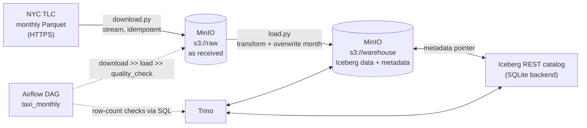

# Iceberg Lakehouse Demo

A small, end-to-end lakehouse built by hand: NYC taxi trip data lands in object storage, is loaded into an **Apache Iceberg** table with **PyIceberg**, orchestrated by **Airflow**, quality-checked and queried with **Trino**. It demonstrates the four Iceberg capabilities that matter most in practice: **schema evolution, partition evolution, time travel and compaction**.

> **Scope.** This is a portfolio project, not production experience. I design data platforms for a living; I built this one myself to show the implementation behind the designs. I used an AI assistant to speed up the coding, and I can explain and change every line.

## Architecture



| Layer | Tool | Role |
|---|---|---|
| Object storage | MinIO (community build `pgsty/minio`) | S3-compatible storage for raw files and Iceberg tables |
| Table format | Apache Iceberg (format v2) | ACID tables, snapshots, schema/partition evolution |
| Catalog | Iceberg REST catalog (`apache/iceberg-rest-fixture`) | Holds each table's pointer to its current metadata |
| Ingestion | Python, PyArrow, PyIceberg | Download, transform, idempotent load |
| Query and maintenance | Trino 477 | SQL, time travel, partition changes, compaction |
| Orchestration | Airflow 3 (standalone) | Monthly schedule with backfill, retries, quality gate |
| Dev environment | GitHub Codespaces + Docker Compose | One-click, reproducible stack |

## Quickstart

1. Open the repo in a GitHub Codespace (4-core / 16 GB). The stack starts automatically.
2. Check it: `make ps` (4 containers: minio, rest, trino, airflow) and `make smoke` (end-to-end Trino → catalog → MinIO test).
3. Run the pipeline, either way:
   - **By hand:** `make download MONTH=2024-11`, then `make load MONTH=2024-11`, then `make dq MONTH=2024-11`
   - **With Airflow:** open port 8081 and unpause `taxi_monthly`. It backfills 2024-11 to 2025-01, one month at a time.
4. Explore: `make trino` for a SQL shell, port 9001 for the MinIO console, port 8080 for the Trino UI.
5. Run the feature demos: `make demo FILE=02_schema_evolution` (see [sql/demos](sql/demos)).

Tests: `make test` (unit tests for the transform, no Docker needed).

## The pipeline

| Step | Code | What it does |
|---|---|---|
| Download | `src/taxi/download.py` | Streams one month's file from TLC into `s3://raw`, unchanged. Skips if already landed. |
| Transform | `src/taxi/transform.py` | Pure functions on Arrow tables: snake_case names, keep only rows inside the file's month. Unit-tested. |
| Load | `src/taxi/load.py` | Creates the table on first run (partitioned by `month(pickup_ts)`), evolves the schema, aligns columns, then **overwrites exactly one month** in one atomic commit. |
| Quality | `src/taxi/quality.py` | Compares the source row count (Parquet footer) with the loaded count (Trino). Fails the run if nothing loaded, if rows were duplicated, or if more than 1% was dropped. |
| Orchestrate | `dags/taxi_monthly.py` | `download >> load >> quality_check` per month; `catchup=True`, `max_active_runs=1`, 2 retries. |

The transform drops a small number of rows with pickup dates outside the file's month: 50 in 2024-11 (3,646,369 → 3,646,319) and 22 in 2025-01 (3,475,226 → 3,475,204).

## Iceberg features, demonstrated

Full outputs are in [docs/results.md](docs/results.md).

### 1. Idempotent loads
Each load replaces one month: a delete plus an append committed together. After the first manual load, three Airflow backfill runs and repeated reloads, the counts are unchanged:

| Month | Trips |
|---|---|
| 2024-11 | 3,646,319 |
| 2024-12 | 3,668,337 |
| 2025-01 | 3,475,204 |

### 2. Schema evolution
The 2025-01 source file adds a new column, `cbd_congestion_fee`. The loader merges it into the table schema by name (`union_by_name`). This is a metadata-only change: no existing file is rewritten.

| Month | Trips | Rows with the new fee |
|---|---|---|
| 2024-11 | 3,646,319 | 0 (NULL, as expected) |
| 2024-12 | 3,668,337 | 0 |
| 2025-01 | 3,475,204 | 3,475,204 |

### 3. Time travel
Every commit is a snapshot. Querying the table as of the snapshot before January was first loaded returns only November and December:

```sql
SELECT count(*) FROM iceberg.nyc.yellow_trips;                                   -- 10,789,860
SELECT count(*) FROM iceberg.nyc.yellow_trips FOR VERSION AS OF 4136408840516862766;  -- 7,314,656
```

The snapshot history also shows intermediate states, such as a month deleted and not yet re-added, that no reader ever saw, because each delete and append pair was committed in a single transaction.

### 4. Partition evolution
The table was switched from monthly to daily partitions with one metadata-only `ALTER TABLE`. December was then reloaded; November and January were left alone. One table now holds both layouts, and the same SQL works across both.

| Spec | Layout | Files | Rows |
|---|---|---|---|
| 1 | `month(pickup_ts)`: Nov, Jan | 3 | 7,121,523 |
| 2 | `day(pickup_ts)`: Dec | 31 | 3,668,337 |

Effect on a one-day query (`EXPLAIN ANALYZE`):

| | Monthly (Nov) | Daily (Dec) |
|---|---|---|
| Rows read | 2,538,993 | **138,189** |
| Rows read then discarded | 95.5% | **0%** |
| Physical bytes read | 11.6 MB | **2.2 MB** |

### 5. Compaction and snapshot expiry
On a separate demo table, writing one month with a 2 MB file-size cap created the small-files problem on purpose.

| | Files | Avg size |
|---|---|---|
| Before `optimize` | 217 | 0.3 MB |
| After `optimize` | 1 | 57.4 MB |

`optimize` commits a `replace` snapshot, but the old small files stay on storage because the previous snapshot still references them. `expire_snapshots` removes them, and with them the ability to time travel to the pre-compaction state.

## Design decisions and trade-offs

| Decision | Why | Trade-off / alternative |
|---|---|---|
| **PyIceberg for writes, Trino for SQL** | One month fits in memory; no Spark cluster or JVM config to run and explain. Trino covers DDL, time travel and maintenance in SQL. | Doesn't scale to very large batches. At scale: Spark or Flink for writes, Trino for reads. Same table, same catalog. |
| **REST catalog** | The open standard that managed catalogs implement (Polaris, Unity, Glue, Snowflake Open Catalog), and one catalog shared by PyIceberg and Trino. | The fixture stores state in SQLite. Losing that file loses the tables even though the files remain. Production needs a managed, backed-up catalog. |
| **Raw landing zone kept unchanged** | Replays and audits always start from the original file. | Extra storage; acceptable for raw data. |
| **Overwrite by month, not append** | Reruns and backfills are safe; retries can't duplicate data. | Assumes the source delivers whole months. For changing records, use `MERGE` on a key. |
| **Partition by `month(pickup_ts)`** | Matches the load unit and the common filter. | Coarse for day-level queries, which is why the demo evolves it to daily. |
| **Automatic schema evolution (`union_by_name`)** | New source columns flow in without code changes. | Also lets in unexpected columns. In production, gate it with a schema contract check. |
| **Timestamps kept as NYC local time** | TLC defines them as local, without a time zone. | Cross-time-zone analysis would need an explicit conversion. |
| **Pure, unit-tested transform** | Fast tests with no Docker; I/O stays at the edges. | Data quality is checked separately, after the load. |
| **Airflow run history is disposable** | The pipeline is idempotent, so a fresh Airflow reproduces the same tables. | No long-term run audit trail. Production would use Postgres for Airflow's database. |
| **`max_active_runs=1`** | Months load in order, which keeps schema evolution chronological. | Slower backfills; acceptable at this scale. |

## What I'd change for production

- Managed object storage (S3, ADLS, GCS) and a managed REST catalog, with IAM roles instead of static keys.
- Spark or Flink for large writes; streaming ingestion where freshness matters.
- A schema contract check before `union_by_name`, and richer quality checks (nulls, ranges, distribution drift).
- Scheduled maintenance: `optimize` on recent partitions, `expire_snapshots` and `remove_orphan_files` under an agreed retention policy.
- Airflow on Kubernetes or a managed service, with Postgres metadata, git-synced DAGs and alerting.
- CI that runs lint, unit tests and an integration test against a disposable stack.

## Repository layout

```
.devcontainer/devcontainer.json   Codespace definition (machine size, startup)
docker-compose.yml                MinIO, REST catalog, Trino, Airflow
airflow/                          Airflow image with the pipeline's dependencies
dags/taxi_monthly.py              Monthly DAG
src/taxi/                         config, download, transform, load, quality
tests/                            Unit tests for the transform
trino/catalog/iceberg.properties  Trino ↔ REST catalog ↔ MinIO connection
sql/smoke.sql                     End-to-end smoke test
sql/demos/                        Feature demos (time travel, evolution, compaction)
scripts/init_buckets.py           Creates the raw and warehouse buckets
docs/results.md                   Captured demo outputs
Makefile                          up, down, smoke, download, load, dq, demo, test
```

## Notes

- MinIO stopped publishing official Docker images in late 2025, so this project uses `pgsty/minio`, a community-maintained build. In production, object storage would be a managed service.
- The local setup uses demo-only credentials and relaxed snapshot-retention limits. Neither is suitable outside a laptop or codespace.
